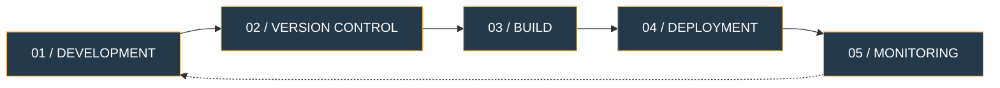

 

 

 

---

## 01. PROFILE

### DevOps Engineering & Infrastructure

I'm a Computer Science student at Khujand Polytechnic Institute, Tajik Technical University, focused on **DevOps Engineering and Linux infrastructure**, with a background in backend and web application development.

My technical interests are centered around the systems behind software: Linux environments, infrastructure, deployment processes, automation, and reliable application operation.

I also develop web applications, work with databases, and apply programming knowledge to practical projects.

**My primary direction is DevOps Engineering. Backend Development is my secondary specialization.**

| | |
|:---|:---|
| **Location** | Tajikistan |
| **Education** | Khujand Polytechnic Institute |
| **Primary Direction** | DevOps Engineering |
| **Secondary Direction** | Backend Development |
| **Operating System** | Ubuntu Linux |
| **Interests** | Infrastructure, Automation, Cybersecurity |

---

## 02. TECHNICAL SKILLS

### Backend Development

### Frontend Development

### Development Environment

---

## 03. DEVOPS ENGINEERING

My primary career direction is DevOps Engineering.

I am developing my understanding of Linux systems and the infrastructure behind modern applications, with a focus on building a solid technical foundation.

### Infrastructure Learning Roadmap

| Domain | Focus |
|:---|:---|
| Linux | Command line and system fundamentals |
| System Administration | Working with Linux environments |
| Automation | Infrastructure and repetitive task automation |
| Containers | Application containerization |
| Version Control | Source code management |
| Networking | Infrastructure networking fundamentals |
| CI/CD | Automated build and deployment |
| Cloud | Cloud infrastructure |
| Infrastructure as Code | Infrastructure management |
| Monitoring | System monitoring and observability |

### Engineering Workflow

---

## 04. BACKEND DEVELOPMENT

Backend development is my secondary technical direction.

My experience includes developing web applications, implementing application logic, and working with relational databases.

**Main technologies:**

- PHP
- MySQL
- SQL
- JavaScript
- HTML5
- CSS3

---

## 05. SELECTED PROJECTS

### 01 — Electronic Library

**University Library Management System**

A web application designed to organize academic resources and simplify library management at a university department.

**Key functionality:**
- Book and academic resource management.
- Student and staff roles.
- Administrative functionality.
- Database-driven resource organization.

**Technologies:** PHP, MySQL, HTML, CSS, JavaScript.

---

### 02 — SolarPanel

**Solar Energy Service Platform**

A web application for a solar panel installation and service company.

**Key functionality:**
- Customer booking system.
- Appointment management.
- Administrative approval workflow.
- Employee task and status management.
- Database-driven functionality.
- Customer service workflow.

**Technologies:** PHP, MySQL, HTML, CSS, JavaScript.

---

### 03 — Finora

**Personal Finance Management Application**

PROJECT STATUS: PLANNED / IN DEVELOPMENT

A planned personal finance application focused on organizing personal income, expenses, and budgets.

**Planned functionality:**
- Income and expense tracking.
- TJS and USD currency support.
- Budget management.
- Local data storage.
- Financial statistics and overview.

---

## 06. DEVELOPMENT ENVIRONMENT

---

## 07. GITHUB ANALYTICS

---

## 08. ENGINEERING PRINCIPLES

| Principle | Approach |
|:---|:---|
| Reliability | Build systems with predictable behavior |
| Automation | Reduce repetitive manual operations |
| Simplicity | Prefer understandable solutions |
| Security | Consider security throughout development |
| Maintainability | Write structured and maintainable code |
| Continuous Improvement | Learn, practice, and refine |

---

## 09. LANGUAGES

| Language | Level |
|:---|:---|
| Tajik | Native |
| Russian | Fluent |
| German | B1 |
| English | A2 |

---

## 10. CONTACT

  

**ENGINEERING • INFRASTRUCTURE • CONTINUOUS IMPROVEMENT**

Designed by Murod Temurzoda

