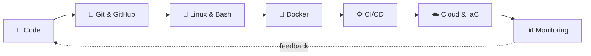

<div align="center">

[](https://github.com/tmrzdmurod)

<a href="https://git.io/typing-svg">
  
</a>


</div>

---

## 👋 About Me

I'm a Computer Science student from Tajikistan, interested in backend development, web technologies, Linux systems, and DevOps engineering.

I enjoy building practical applications, understanding how software works under the hood, and improving my engineering skills through hands-on projects.

- 🎓 Computer Science student at Khujand Polytechnic Institute, Tajik Technical University
- 💻 Interested in Backend Development and Software Engineering
- 🐧 Learning Linux and Bash from the fundamentals
- ⚙️ Exploring DevOps, Docker, and server infrastructure
- 🗄️ Working with PHP, MySQL, and web application development
- 📱 Exploring Android development with Kotlin and Jetpack Compose
- 🎯 **Goal:** Become a professional Backend / DevOps Engineer

```python
class Murod:
    def __init__(self):
        self.location = "Tajikistan"
        self.role = "Aspiring Software Engineer"
        self.interests = ["Backend Development", "DevOps", "Linux", "Cybersecurity", "Software Architecture"]
        self.current_focus = ["Linux & Bash", "Git & GitHub", "Docker", "Backend Engineering"]

    def say_hello(self):
        return "Always learning. Always building."
```

---

## 🛠️ Tech Stack

<div align="center">


**Currently exploring:**


</div>

---

## 🚀 Featured Projects

### 📚 Electronic Library
**University Library Management System**

A web application designed to organize academic resources and simplify library management.

- Book and resource management
- Student and staff roles
- Administrative functionality
- Structured database management

**Technologies:** PHP, MySQL, HTML, CSS, JavaScript

### ☀️ SolarPanel
**Solar Energy Service Platform**

A web application for a solar panel installation and service company.

- Customer booking system
- Appointment management
- Administrative approval workflow
- Employee task and status management
- Database-driven functionality

**Technologies:** PHP, MySQL, HTML, CSS, JavaScript

### 💰 Finora
**Personal Finance Android Application (In Progress)**

A personal finance application focused on tracking income, expenses, and budgets.

- Income and expense management
- TJS and USD currencies
- Budget tracking
- Local data storage
- Financial overview

**Technologies:** Kotlin, Jetpack Compose, Room, SQLite

---

## ♾️ DevOps Learning Journey

I'm building my DevOps foundation from the ground up. The goal is to understand not only how to develop applications, but also how to **deploy, maintain, and operate** them.



**Roadmap progress:**

- [x] Linux fundamentals (ongoing practical learning)
- [ ] Bash scripting
- [ ] Git and GitHub workflows
- [ ] Docker and containerization
- [ ] Networking fundamentals
- [ ] CI/CD pipelines
- [ ] Cloud infrastructure
- [ ] Infrastructure as Code
- [ ] Monitoring and observability


---

## 📊 GitHub Stats

<div align="center">


</div>

---

## 🎯 Engineering Principles

- Write clean and maintainable code
- Understand fundamentals before using abstractions
- Build real projects instead of only following tutorials
- Learn through practice and experimentation
- Improve continuously

---

## 🌍 Languages

- Tajik: Native
- Russian: Fluent
- German: B1
- English: A2

---

## 📫 Connect With Me

[](https://github.com/tmrzdmurod)
[](https://t.me/temurzadee)
[](mailto:tmrzdmurod@gmail.com)

---

<p align="center">
  
</p>

<p align="center">
  <i>"First, understand how it works. Then, make it better."</i>
</p>
