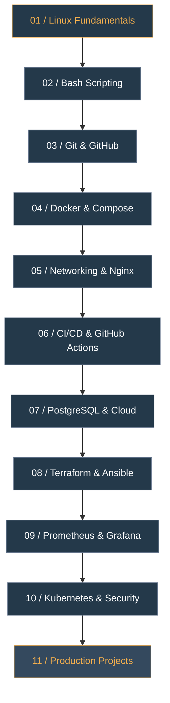

 

 

 

---

## 01. PROFILE

### DevOps Engineering & Infrastructure

I'm a Computer Science student at Khujand Polytechnic Institute, Tajik Technical University, focused on **DevOps Engineering and Linux infrastructure**, with a background in backend and web application development.

My technical interests are centered around the systems behind software: Linux environments, infrastructure, deployment processes, automation, and reliable application operation.

I also develop web applications, work with databases, and apply programming knowledge to practical projects.

**My primary direction is DevOps Engineering. Backend Development is my secondary specialization.**

| | |
|:---|:---|
| **Location** | Tajikistan |
| **Education** | Khujand Polytechnic Institute |
| **Primary Direction** | DevOps Engineering |
| **Secondary Direction** | Backend Development |
| **Operating System** | Ubuntu Linux |
| **Interests** | Infrastructure, Automation, Cybersecurity |

---

## 02. TECHNICAL SKILLS

### Backend Development

### Frontend Development

### Development Environment

---

## 03. DEVOPS ENGINEERING

My primary engineering direction is **DevOps Engineering**, with a focus on Linux administration, infrastructure automation, containerization, and software delivery.

I'm following a structured learning roadmap that covers the complete infrastructure lifecycle — from Linux fundamentals to cloud infrastructure, CI/CD, and monitoring.

### Core Infrastructure Stack

### Infrastructure Learning Roadmap

| Domain | Technologies & Tools |
|:---|:---|
| Linux Administration | Linux, Ubuntu, Filesystem, Permissions, Processes |
| Shell Automation | Bash, Shell Scripting |
| Version Control | Git, GitHub |
| Containerization | Docker, Docker Compose |
| Networking | TCP/IP, DNS, HTTP/HTTPS, Ports |
| Web Infrastructure | Nginx, Web Servers |
| CI/CD | GitHub Actions, Automated Pipelines |
| Databases | PostgreSQL, MySQL |
| Cloud Computing | Cloud Infrastructure |
| Infrastructure as Code | Terraform |
| Configuration Management | Ansible |
| Monitoring | Prometheus, Grafana |
| Orchestration | Kubernetes |
| Security | Linux Security, SSH, Infrastructure Security |

### DevOps Engineering Workflow

**Target:** Build, deploy, automate, secure, and monitor production-ready applications and infrastructure.

---

## 04. BACKEND DEVELOPMENT

Backend Development is my secondary specialization.

My experience includes building database-driven web applications, implementing server-side functionality, and working with relational databases.

### Backend Technologies

### Development Areas

- Server-side application logic.
- Relational database design and SQL queries.
- CRUD operations and data management.
- User roles and access management.
- Application architecture.
- Database-driven web applications.
- Backend and frontend integration.

### Future Technical Direction

My long-term backend development direction includes:

- REST API development.
- PostgreSQL database management.
- Backend application deployment.
- Web server configuration.
- Docker-based application environments.
- Integration of backend services into CI/CD pipelines.

**Goal:** Understand the complete application lifecycle — from backend development to deployment and infrastructure management.

---

## 05. SELECTED PROJECTS

### 01 — Electronic Library

**University Library Management System**

A web application designed to organize academic resources and simplify library management at a university department.

**Key functionality:**
- Book and academic resource management.
- Student and staff roles.
- Administrative functionality.
- Database-driven resource organization.

**Technologies:** PHP, MySQL, HTML, CSS, JavaScript.

### 02 — SolarPanel

**Solar Energy Service Platform**

A web application for a solar panel installation and service company.

**Key functionality:**
- Customer booking system.
- Appointment management.
- Administrative approval workflow.
- Employee task and status management.
- Database-driven functionality.
- Customer service workflow.

**Technologies:** PHP, MySQL, HTML, CSS, JavaScript.

### 03 — Finora

**Personal Finance Management Application**

PROJECT STATUS: PLANNED / IN DEVELOPMENT

A planned personal finance application focused on organizing personal income, expenses, and budgets.

**Planned functionality:**
- Income and expense tracking.
- TJS and USD currency support.
- Budget management.
- Local data storage.
- Financial statistics and overview.

---

## 06. DEVELOPMENT ENVIRONMENT

---

## 07. GITHUB ANALYTICS

---

## 08. ENGINEERING PRINCIPLES

| Principle | Approach |
|:---|:---|
| Reliability | Build systems with predictable behavior |
| Automation | Reduce repetitive manual operations |
| Simplicity | Prefer understandable solutions |
| Security | Consider security throughout development |
| Maintainability | Write structured and maintainable code |
| Continuous Improvement | Learn, practice, and refine |

---

## 09. LANGUAGES

| Language | Level |
|:---|:---|
| Tajik | Native |
| Russian | Fluent |
| German | B1 |
| English | A2 |

---

## 10. CONTACT

 

**ENGINEERING • INFRASTRUCTURE • CONTINUOUS IMPROVEMENT**

Designed by Murod Temurzoda

