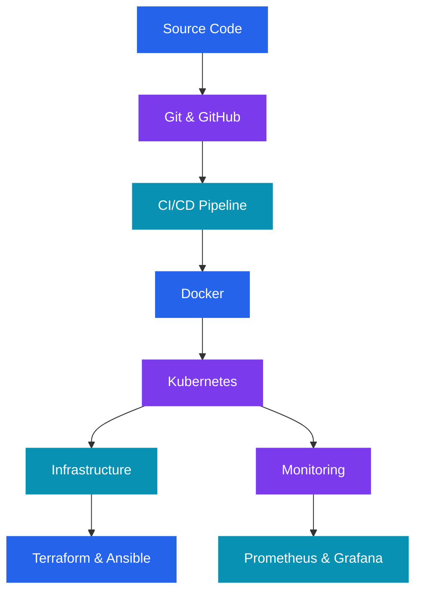

# Hi, I'm Murod Temurzoda

## About Me

I'm a Computer Science student at **Khujand Polytechnic Institute of Tajik Technical University**.

My primary professional direction is **DevOps Engineering**. I focus on infrastructure, automation, containerization, deployment pipelines, monitoring, and reliable system operations.

My secondary direction is **Backend Development**, where I build database-driven web applications and server-side functionality.

- Focus: DevOps Engineering & Infrastructure
- Secondary specialization: Backend Development
- Operating System: Ubuntu Linux
- Interested in automation, cloud infrastructure, and scalable systems
- Always learning, building, and improving

---

## DevOps Engineering

### Infrastructure · Automation · Deployment · Monitoring

| Area | Technologies |
|---|---|
| Operating Systems | Linux, Ubuntu |
| Scripting | Bash |
| Version Control | Git, GitHub |
| Containers | Docker, Docker Compose |
| CI/CD | GitHub Actions |
| Infrastructure as Code | Terraform |
| Configuration Management | Ansible |
| Orchestration | Kubernetes |
| Web Servers | Nginx |
| Monitoring | Prometheus, Grafana |
| Databases | PostgreSQL, MySQL |
| Networking | TCP/IP, DNS, HTTP/HTTPS, Ports |
| Security | SSH, Linux and Infrastructure Security |
| Cloud | Cloud Infrastructure |

### DevOps Workflow

---

## Backend Development

My secondary technical direction is backend and web application development.

**Technologies**

- PHP
- MySQL
- JavaScript
- HTML5
- CSS3

**Development Areas**

- Server-side application logic
- Database design and SQL queries
- CRUD operations
- User roles and access management
- Database-driven applications
- Frontend and backend integration
- Application structure and functionality

---

## Featured Projects

### 1. Electronic Library

A web-based library management system developed for an academic department.

**Key Features**
- Book and educational resource management
- Student and staff roles
- Administrative functionality
- Database-driven operations

**Stack:** PHP · MySQL · JavaScript · HTML · CSS

### 2. SolarPanel

A web application for a solar panel installation and service company.

**Key Features**
- Customer booking system
- Appointment management
- Administrator approval workflow
- Employee task and status management
- Database-driven functionality

**Stack:** PHP · MySQL · JavaScript · HTML · CSS

### 3. Finora

IN DEVELOPMENT

A personal finance application concept focused on managing everyday finances.

**Planned Features**
- Income and expense tracking
- TJS and USD currencies
- Budget management
- Financial overview
- Local data storage

---

## Technology Overview

---

## GitHub Statistics

---

## Languages

| Language | Level |
|---|---|
| Tajik | Native |
| Russian | Fluent |
| German | B1 |
| English | A2 |

---

## Connect With Me

