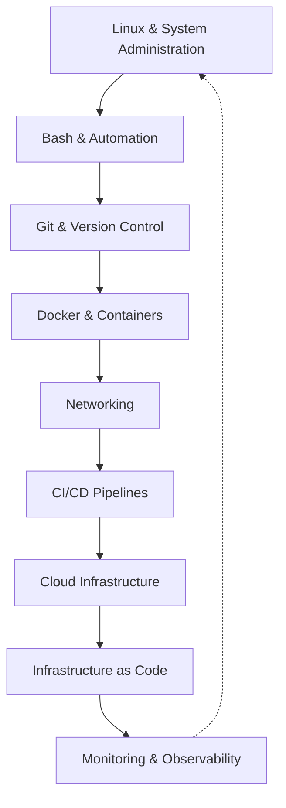

 <div align="center">

[](https://github.com/tmrzdmurod)

<a href="https://git.io/typing-svg">
  
</a>


</div>

---

## 👨‍💻 About Me

I'm a Software Developer focused on **DevOps engineering, Linux systems, and infrastructure automation**, with a background in backend and web application development.

My work combines software development with an understanding of the systems behind it — from application architecture and database management to Linux environments, deployment workflows, and infrastructure.

I build practical applications, work with databases, manage development environments, and continuously improve my understanding of how software is developed, deployed, and maintained.

**My primary focus is DevOps engineering**, while backend development remains an important part of my technical background.

- 🐧 Working with Linux and Ubuntu environments.
- ⚙️ Building a foundation in DevOps, infrastructure, and automation.
- 🐳 Working towards containerization and deployment with Docker.
- 🔧 Developing command-line and system administration skills with Bash.
- 🌐 Building backend applications using PHP and MySQL.
- 🗄️ Designing database-driven applications and managing application logic.
- 🎓 Computer Science student at Khujand Polytechnic Institute, Tajik Technical University.

```python
class Murod:
    def __init__(self):
        self.location = "Tajikistan"
        self.primary_field = "DevOps Engineering"
        self.secondary_field = "Backend Development"

        self.technologies = {
            "development": ["PHP", "Python", "JavaScript"],
            "databases": ["MySQL", "SQLite"],
            "systems": ["Linux", "Ubuntu", "Bash"],
            "tools": ["Git", "GitHub", "Docker"]
        }

        self.interests = [
            "Infrastructure Automation",
            "Linux Administration",
            "CI/CD",
            "Cloud Computing",
            "Cybersecurity"
        ]

    def philosophy(self):
        return "Build it. Deploy it. Understand it. Improve it."
```

---

## ⚙️ DevOps & Infrastructure

My primary engineering direction is DevOps: understanding Linux environments, application deployment, infrastructure, automation, and the processes that keep software running reliably.

### Core Technologies

<div align="center">


</div>

### Current Learning Path

- Linux system administration
- Bash scripting and automation
- Git workflows and version control
- Docker and containerization
- Networking fundamentals
- CI/CD and deployment automation
- Cloud infrastructure
- Infrastructure as Code (IaC)
- Monitoring and observability

---

## 💻 Backend Development

Backend development is my secondary specialization. I work with server-side logic, databases, and web application architecture.

<div align="center">


</div>

### Additional Technologies


---

## 🚀 Featured Projects

### 📚 Electronic Library
**University Library Management System**

A web-based platform designed to organize academic resources and simplify university library management.

- Book and academic resource management.
- Student and staff roles.
- Administrative functionality.
- Database-driven architecture.

**Technologies:** PHP, MySQL, HTML, CSS, JavaScript.

### ☀️ SolarPanel
**Solar Energy Service Platform**

A web application for a solar panel installation and service company.

- Customer booking system.
- Appointment management.
- Administrative approval workflow.
- Employee task and status management.
- Database-driven functionality.

**Technologies:** PHP, MySQL, HTML, CSS, JavaScript.

### 💰 Finora
**Personal Finance Android Application — In Progress**

A personal finance application designed to simplify income, expense, and budget management.

- Income and expense tracking.
- TJS and USD currencies.
- Budget management.
- Local database storage.
- Financial overview.

**Technologies:** Kotlin, Jetpack Compose, Room, SQLite.

---

## ♾️ DevOps Engineering Roadmap

My goal is to build the technical foundation required to manage the complete software delivery lifecycle.



---

## 📊 GitHub Statistics

<div align="center">


</div>

---

## 🎯 Engineering Principles

- Understand systems, not just commands.
- Automate repetitive tasks whenever possible.
- Build reliable and maintainable solutions.
- Focus on security, performance, and scalability.
- Learn through practical implementation.
- Keep improving engineering fundamentals.

---

## 🌍 Languages

- Tajik — Native
- Russian — Fluent
- German — B1
- English — A2

---

## 📫 Connect With Me

<div align="center">

[](https://github.com/tmrzdmurod)
[](https://t.me/temurzadee)
[](mailto:tmrzdmurod@gmail.com)

</div>

---

<p align="center">
  
</p>

<p align="center">
  <i>"Build it. Deploy it. Understand it. Improve it."</i>
</p>
