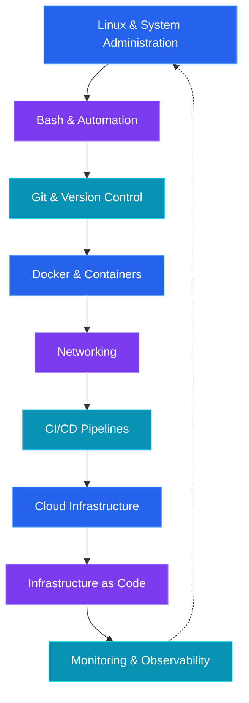

# Murod Temurzoda | DevOps & Backend

<div align="center">


<a href="https://github.com/tmrzdmurod">

</a>
<a href="https://t.me/temurzadee">

</a>
<a href="mailto:tmrzdmurod@gmail.com">

</a>

<br/>


</div>

---

## 👨‍💻 About Me

I'm a Software Developer focused on **DevOps engineering, Linux systems, and infrastructure automation**, with a background in backend and web application development.

My work combines software development with an understanding of the systems behind it — from application architecture and database management to Linux environments, deployment workflows, and infrastructure.

I build practical applications, work with databases, manage development environments, and continuously improve my understanding of how software is developed, deployed, and maintained.

**My primary focus is DevOps engineering**, while backend development remains an important part of my technical background.

- 🐧 Working with Linux and Ubuntu environments.
- ⚙️ Building a foundation in DevOps, infrastructure, and automation.
- 🐳 Working towards containerization and deployment with Docker.
- 🔧 Developing command-line and system administration skills with Bash.
- 🌐 Building backend applications using PHP and MySQL.
- 🗄️ Designing database-driven applications and managing application logic.
- 🎓 Computer Science student at Khujand Polytechnic Institute, Tajik Technical University.

```python
class Murod:
    def __init__(self):
        self.location = "Tajikistan"
        self.primary_field = "DevOps Engineering"
        self.secondary_field = "Backend Development"

        self.technologies = {
            "development": ["PHP", "Python", "JavaScript"],
            "databases": ["MySQL", "SQLite"],
            "systems": ["Linux", "Ubuntu", "Bash"],
            "tools": ["Git", "GitHub", "Docker"]
        }

        self.interests = [
            "Infrastructure Automation",
            "Linux Administration",
            "CI/CD",
            "Cloud Computing",
            "Cybersecurity"
        ]

    def philosophy(self):
        return "Build it. Deploy it. Understand it. Improve it."
```

---

## ⚙️ DevOps & Infrastructure

My primary engineering direction is DevOps: understanding Linux environments, application deployment, infrastructure, automation, and the processes that keep software running reliably.

### Core Technologies

<div align="center">


</div>

### Current Learning Path

- Linux system administration
- Bash scripting and automation
- Git workflows and version control
- Docker and containerization
- Networking fundamentals
- CI/CD and deployment automation
- Cloud infrastructure
- Infrastructure as Code (IaC)
- Monitoring and observability

---

## 💻 Backend Development

Backend development is my secondary specialization. I work with server-side logic, databases, and web application architecture.

<div align="center">


</div>

### Additional Technologies

<div align="center">


</div>

---

## 🚀 Featured Projects

<div align="center">


</div>

### 📚 Electronic Library

**University Library Management System**

A web-based platform designed to organize academic resources and simplify university library management.

- Book and academic resource management.
- Student and staff roles.
- Administrative functionality.
- Database-driven architecture.

<div align="left">


</div>

### ☀️ SolarPanel

**Solar Energy Service Platform**

A web application for a solar panel installation and service company.

- Customer booking system.
- Appointment management.
- Administrative approval workflow.
- Employee task and status management.
- Database-driven functionality.

<div align="left">


</div>

### 💰 Finora

**Personal Finance Android Application — In Progress**

A personal finance application designed to simplify income, expense, and budget management.

- Income and expense tracking.
- TJS and USD currencies.
- Budget management.
- Local database storage.
- Financial overview.

<div align="left">


</div>

---

## ♾️ DevOps Engineering Roadmap

My goal is to build the technical foundation required to manage the complete software delivery lifecycle.



---

## 📊 GitHub Statistics

<div align="center">


<br/>


</div>

---

## 🎯 Engineering Principles

- Understand systems, not just commands.
- Automate repetitive tasks whenever possible.
- Build reliable and maintainable solutions.
- Focus on security, performance, and scalability.
- Learn through practical implementation.
- Keep improving engineering fundamentals.

---

## 🌍 Languages

<div align="center">

| Language | Level |
|:---:|:---:|
| Tajik | Native |
| Russian | Fluent |
| German | B1 |
| English | A2 |

</div>

---

## 📫 Connect With Me

<div align="center">

<a href="https://github.com/tmrzdmurod">

</a>

<a href="https://t.me/temurzadee">

</a>

<a href="mailto:tmrzdmurod@gmail.com">

</a>

</div>

---

<div align="center">


<i>"Build it. Deploy it. Understand it. Improve it."</i>

</div>
