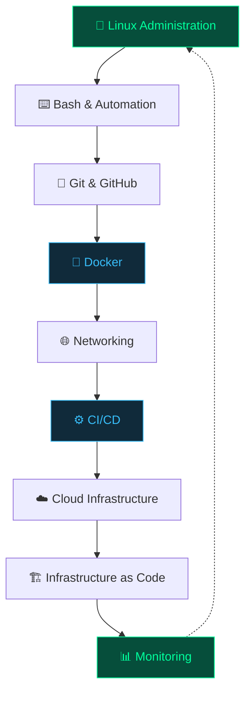

 <div align="center">


<a href="https://readme-typing-svg.demolab.com">

</a>

<br/>


</div>

---

## `01 // ABOUT ME`

I'm a Software Developer focused on **DevOps Engineering, Linux Systems, and Infrastructure Automation**, with a background in backend and web application development.

I work at the intersection of software development and infrastructure, combining application development, database management, Linux environments, and deployment workflows.

My primary direction is **DevOps Engineering** — building the skills and practical experience needed to automate, deploy, monitor, and maintain reliable software systems.

- `EDUCATION` — Computer Science, Khujand Polytechnic Institute
- `PRIMARY` — DevOps & Infrastructure
- `SECONDARY` — Backend Development
- `SYSTEM` — Ubuntu / Linux
- `BACKEND` — PHP / MySQL
- `INTERESTS` — Automation, CI/CD, Cloud, Cybersecurity

```bash
murod@devops:~$ cat profile.txt

Name:       Murod Temurzoda
Location:   Tajikistan
Role:       Software Developer
Focus:      DevOps Engineering
Background: Backend Development
Environment: Linux / Ubuntu

murod@devops:~$ echo "Building reliable systems."
Building reliable systems.
```

---

## `02 // DEVOPS & INFRASTRUCTURE`

<div align="center">


</div>

### Infrastructure Focus

| Area | Focus |
|:---|:---|
| Linux | System administration |
| Bash | Shell scripting & automation |
| Git | Version control |
| Docker | Containerization |
| Networking | Network fundamentals |
| CI/CD | Build & deployment pipelines |
| Cloud | Cloud infrastructure |
| IaC | Infrastructure as Code |
| Monitoring | System observability |

---

## `03 // BACKEND DEVELOPMENT`

Backend development is my secondary specialization. I build database-driven applications and work with server-side logic and web technologies.

<div align="center">


</div>

---

## `04 // FEATURED PROJECTS`

### 📚 Electronic Library
**University Library Management System**

A web-based platform for organizing academic resources and simplifying university library management.

- Book and academic resource management
- Student and staff roles
- Administrative functionality
- Database-driven architecture

`PHP` `MySQL` `HTML` `CSS` `JavaScript`

### ☀️ SolarPanel
**Solar Energy Service Platform**

A web application for a solar panel installation and service company.

- Customer booking system
- Appointment management
- Administrative approval workflow
- Employee task and status management
- Database-driven functionality

`PHP` `MySQL` `HTML` `CSS` `JavaScript`

### 💰 Finora
**Personal Finance Android Application — In Progress**

A personal finance application for managing income, expenses, and budgets.

- Income and expense tracking
- TJS and USD currencies
- Budget management
- Local database storage
- Financial overview

`Kotlin` `Jetpack Compose` `Room` `SQLite`

---

## `05 // DEVOPS ROADMAP`

My engineering roadmap focuses on the complete software delivery lifecycle.



---

## `06 // DEVELOPMENT ENVIRONMENT`

<div align="center">


</div>

---

## `07 // GITHUB ANALYTICS`

<div align="center">


</div>

---

## `08 // ENGINEERING PRINCIPLES`

```text
[01] Understand the system before changing it.
[02] Automate repetitive operations.
[03] Build reliable and maintainable solutions.
[04] Treat security as a fundamental requirement.
[05] Learn through practical implementation.
[06] Improve continuously.
```

---

## `09 // LANGUAGES`

| Language | Proficiency |
|:---|:---|
| Tajik | Native |
| Russian | Fluent |
| German | B1 |
| English | A2 |

---

## `10 // CONNECT`

<div align="center">

[](https://github.com/tmrzdmurod)
[](https://t.me/temurzadee)
[](mailto:tmrzdmurod@gmail.com)

<br/>


<sub>BUILD • AUTOMATE • DEPLOY • MONITOR</sub>

</div>
